# Claude Agent Office

**A pixel-art office that brings your Claude Code agents to life.**

[](LICENSE)


Claude Agent Office (Agent Office for short) is a free, open-source, local-first visualizer for Claude Code. Every real Claude Code session, subagent and agent-team teammate becomes an animated worker in a pixel-art office. Workers sit at desks whose monitors show what the agent is doing right now, subagents walk in when they are spawned, finished work flies back to the lead, and idle agents take coffee breaks or hold a (clearly simulated) meeting.

It only watches. It never sends prompts, never answers permission requests and never calls a model.

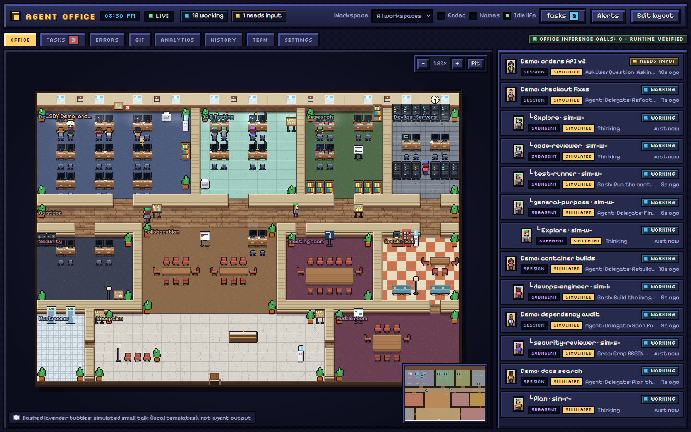

<sub>All screenshots and animations in this README come from the real app, fed with its built-in demo scenarios (`packages/monitor/src/simulate.ts`). Every agent in them is labelled SIMULATED.</sub>

## Contents

- [Highlights](#highlights)
- [Local only, zero extra tokens](#local-only-zero-extra-tokens)
- [Prerequisites](#prerequisites)
- [Quick install](#quick-install)
- [Running the office](#running-the-office)
- [How monitoring works](#how-monitoring-works)
- [Reading the office](#reading-the-office)
- [Subagents and agent teams](#subagents-and-agent-teams)
- [Meetings and collaboration](#meetings-and-collaboration)
- [Simulated office life](#simulated-office-life)
- [Sound](#sound)
- [Token usage](#token-usage)
- [Dashboard views](#dashboard-views)
- [Configuration](#configuration)
- [Screenshot gallery](#screenshot-gallery)
- [Troubleshooting](#troubleshooting)
- [Project structure](#project-structure)
- [Development and testing](#development-and-testing)
- [Uninstall](#uninstall)
- [Contributing](#contributing)
- [License and attribution](#license-and-attribution)

## Highlights

| Feature | What you get |
| --- | --- |
| **Live office** | One worker per real session, subagent and teammate. Desk monitors show the running tool (reading, searching, editing, tests, a shell command, waiting on a subagent), and status bubbles flag permission prompts, questions and failures. |
| **Departments** | A 44 × 30 office with Development, QA & Testing, Research, DevOps and Security rooms, plus meeting, collaboration, huddle and break rooms, a reception and restrooms. Local rules you can edit decide who sits where. |
| **Subagents and teams** | Subagents (including nested ones) and teammates get a desk in their department or next to their lead. Verified delegations, task handoffs and completions are animated between desks. |
| **Inspector** | Click a worker for its current tool, pending permission, tool history, tasks, timing, recent errors, git status and the context size recorded in its transcript. |
| **Dashboard** | Tasks, Errors, Git, Analytics, History (with replay), Team and Settings views. |
| **Simulated office life** | Idle agents chat, fetch coffee, read, stretch and meet, and simulated visitors drop by. It is cosmetic, clearly labelled, and real status always wins. |
| **Sound** | Optional calm lo-fi music and sound effects for real events (an agent arrives, finishes, needs permission, fails), all synthesized in the page with no audio files. Off by default. |
| **VS Code extension** | The same office in a VS Code panel, a status-bar summary, notifications and hook install commands. |
| **Private by design** | Binds to `127.0.0.1` only, drops prompts and tool output in the hook process, keeps only short redacted summaries of tool inputs, and never calls a model. |

## Local only, zero extra tokens

- **No cloud, no account, no database.** The monitor is a small Node.js process on `127.0.0.1`. State is kept in JSON files in `~/.agent-office`.
- **Zero extra Claude tokens.** Running the office causes no model inference: no Anthropic API calls, no Claude CLI or SDK runs, no hidden agents, no `prompt` or `agent` hooks. The hooks it installs are passive: an async command that prints nothing and always exits 0 (or an HTTP hook that gets an empty `204`), so they add nothing to your sessions' context. Idle life, dialogue, meetings, analytics and replay are deterministic local code.
- **Checked, not just promised.** A static source scan, a runtime guard in the monitor, runtime tests with network and process spies, and a browser end-to-end test enforce this. A badge next to the view tabs shows the guard's count (`Office inference calls: 0 · runtime verified`).

The guarantee covers **the office's own activity only**. Your Claude Code sessions use tokens exactly as they would without Agent Office; the office just shows the usage those sessions record. Details, the full audit and how to verify it yourself: [docs/ZERO_TOKEN.md](docs/ZERO_TOKEN.md).

## Prerequisites

- **Node.js 20 or newer** and **npm**.
- **Claude Code**, installed and signed in separately. Agent Office observes it; it does not install, configure or authenticate Claude Code for you.
- Agent Office itself needs **no API key, no account, no cloud backend and no database**.
- **Platform:** developed and tested on **Windows 11**. The code has macOS and Linux paths (browser opener, path handling), so it is expected to work there, but this has not been tested yet.
- Optional: **VS Code** 1.95 or newer for the extension, and **git** for the Git view.

## Quick install

```bash
git clone <repository-url>
cd <repository-folder>
npm install
npm run build
```

Use the clone URL shown on the project's GitHub page in place of `<repository-url>`.

`npm run build` builds the UI, the monitor (with its CLI and hook forwarder) and the VS Code extension bundle.

## Running the office

**1. Start the monitor**

```bash
npm start                      # same as: node packages/monitor/dist/cli.cjs start
npm start -- --open            # also opens the office in your default browser
```

Then open **http://127.0.0.1:47821/**. Inside the repository, `npx agent-office <command>` runs the same CLI, for example `npx agent-office start --open`.

**2. Install the Claude Code hooks** (recommended)

```bash
npx agent-office install-hooks          # dry run: prints the planned change to ~/.claude/settings.json
npx agent-office install-hooks --yes    # apply it; a backup of settings.json is written first
```

Claude Code picks up hook changes automatically; restart a session if its events do not appear. Without hooks the office still shows running sessions from Claude Code's session registry (idle, busy or waiting) plus titles and context size from transcripts, but tool activity, permission prompts, subagents and tasks need hooks. To install only for one project, add `--scope project --project <dir>` (writes `<dir>/.claude/settings.local.json`).

**3. Try it without Claude Code** (optional)

```bash
npm run simulate                        # with a monitor running: sends a scripted demo
npm run simulate -- --linger 120        # keep the demo agents idle for 2 minutes to watch idle life
npm run simulate -- --scenario showcase # busier demo: 5 sessions, parallel and nested subagents, a team
```

Demo sessions use the `sim-` prefix and are labelled **SIMULATED** everywhere in the UI.

**VS Code extension**

```bash
npm run package:vsix                    # builds everything and writes packages/vscode-extension/agent-office.vsix
code --install-extension packages/vscode-extension/agent-office.vsix
```

Run **Agent Office: Open Office** from the command palette. The extension connects to a running monitor or starts one inside VS Code (setting `agentOffice.autoStartMonitor`); if the window that owns the monitor closes, another window takes over. It also adds **Agent Office: Install Claude Code Hooks…** / **Remove Claude Code Hooks…** (choose user settings or this workspace, review the diff, confirm), a status-bar summary, notifications when an agent needs permission or input or a turn fails, a read-only transcript viewer, and an **Open Claude Code** button that only focuses the official Claude Code extension. See [packages/vscode-extension/README.md](packages/vscode-extension/README.md).

## How monitoring works

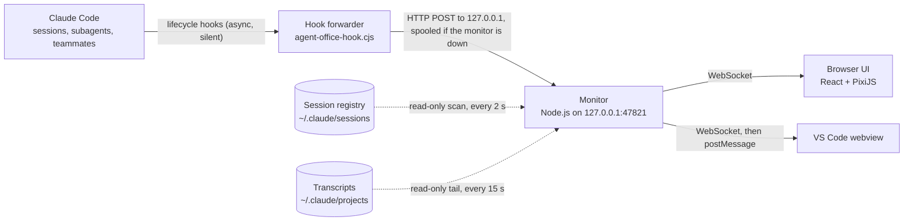

1. **Hooks.** Claude Code runs the Agent Office hook on lifecycle events (`SessionStart`, `PreToolUse`, `PostToolUse`, `SubagentStart`, `TaskCreated`, `Stop` and others). The forwarder drops prompts, tool output and permission suggestions, trims long values, and posts the rest to the monitor, which reduces tool inputs to short summaries with secrets redacted (file contents and edit strings are never stored). If the monitor is down, the event is spooled to disk and replayed later with its original timestamp.
2. **Read-only discovery.** The monitor also scans Claude Code's session registry for running sessions (idle, busy or waiting) and tail-reads transcripts for titles, model, timestamps and recorded token usage. It never writes to these files.
3. **One reducer everywhere.** Every event gets a sequence number and goes through a pure reducer shared by the monitor, the browser and the VS Code webview, so all views show the same state. Statuses only change on evidence: a missing value is shown as `unknown`, never guessed.

The monitor checks the `Host` and `Origin` headers, requires a random local token for ingestion and WebSocket access, and answers hooks with an empty `204`, so nothing it returns can influence Claude Code.

## Reading the office

<table>
<tr>
<td width="50%">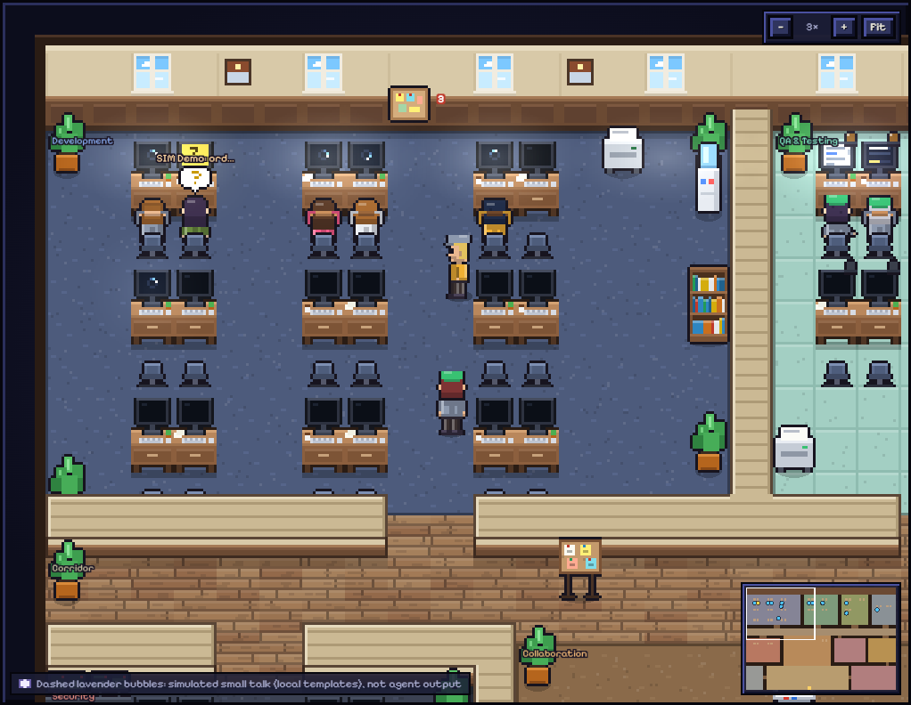</td>
<td width="50%">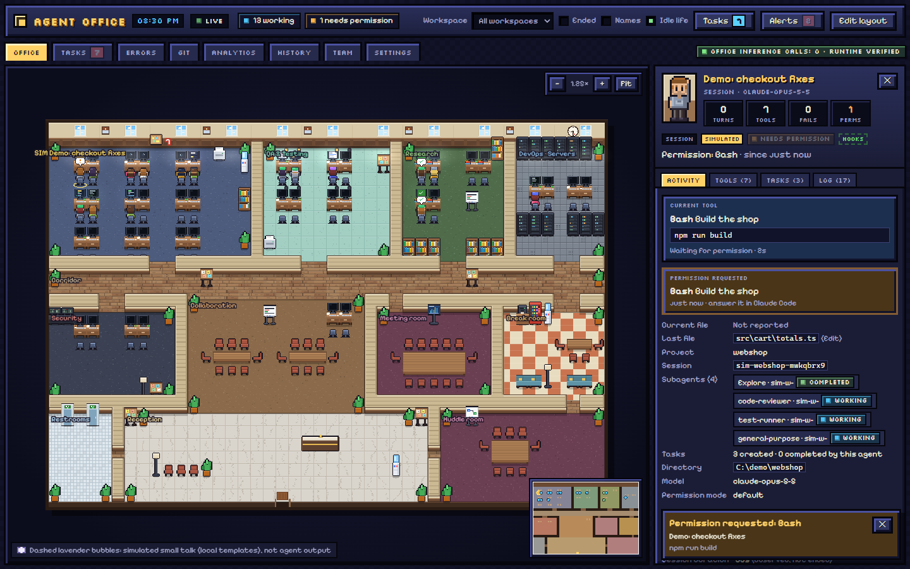</td>
</tr>
<tr>
<td><sub>Development department: each desk monitor shows the agent's real activity.</sub></td>
<td><sub>The inspector for an agent that is waiting for permission.</sub></td>
</tr>
</table>

- **Workers.** One worker per real agent. Shirt colour marks the session, so its subagents share it. Subagents wear caps and teammates wear headsets.
- **Desk monitors** follow the agent's real state and the tool that is running now (fixed local rules, never a model):

  | Screen | Meaning |
  | --- | --- |
  | Scrolling document | Reading (`Read`, `WebFetch`) |
  | Magnifier | Searching (`Grep`, `Glob`, `WebSearch`) |
  | Typed lines with a diff gutter | Editing (`Edit`, `Write`) |
  | Progress bar | A test-like command is running (no pass/fail colour until it ends) |
  | Shell prompt | Another command is running |
  | Bug icon | Debugging: the last tool call failed and nothing has succeeded since |
  | Spinner | Waiting on a subagent or a background job |
  | Dots | Thinking: the model is working on its next step after a tool finished |
  | Flashing orange **!** / yellow **?** | Waiting for your permission / your answer |
  | Red **x** / green check | The turn failed / finished |
  | Screensaver / static | Idle / status unknown |

- **Particles and flights.** Green sparks mean a tool succeeded, grey-red puffs mean it failed, confetti means a subagent completed. A sheet of paper flies from lead to subagent on a verified delegation, a task card on a task handoff, and a check mark back on completion. These fire only for real, verified events.
- **Camera.** Mouse wheel or **+ / −** to zoom, drag or arrow keys to pan, **0** or **Fit** to see everything. The mini-map navigates; clicking a room's floor lists who is in it.
- **Time of day.** Lighting and the wall clock follow your local time (day, dusk, night with glowing monitors). Add `?hour=22` to the URL to preview another hour.
- **Layout editor.** **Edit layout** lets you move desks and furniture, draw walls and rooms, and reset to the default office or the small open office. See [docs/OFFICE_LAYOUT.md](docs/OFFICE_LAYOUT.md).

## Subagents and agent teams

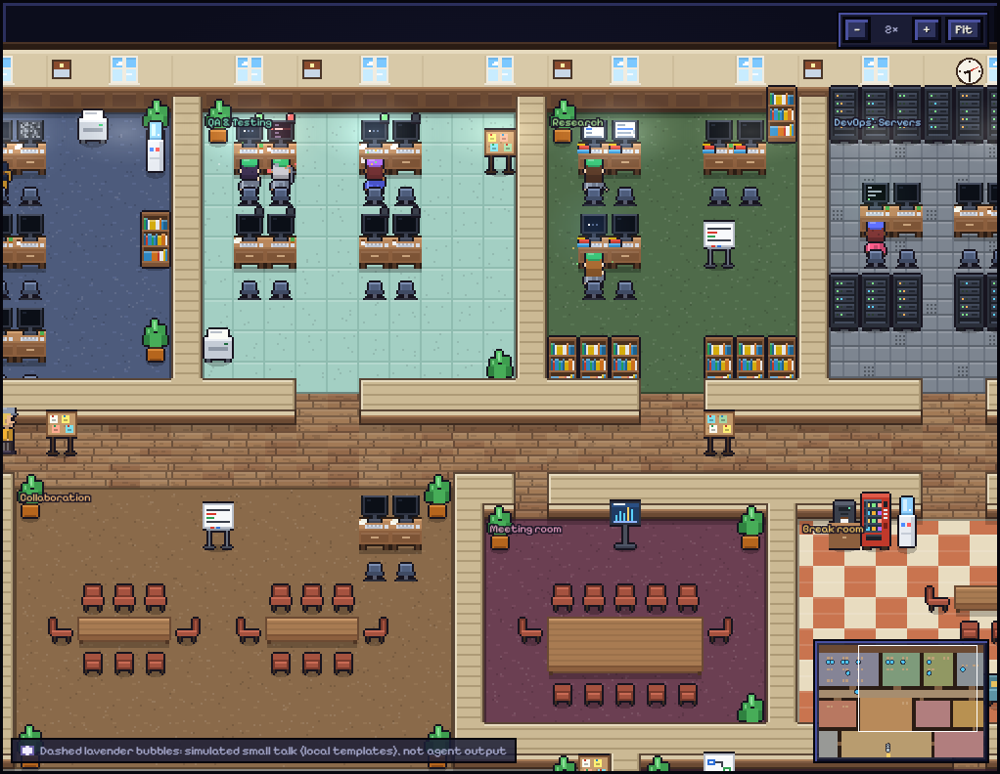

- **Subagents** appear when Claude Code reports `SubagentStart`. A subagent's parent is the agent whose `Agent`/`Task` tool call spawned it, so **nested subagents** are placed under the subagent that spawned them. Without that evidence the link is shown as *inferred*.
- **Teammates** of an agent team are recognised from `TeammateIdle` and from task events that name a teammate.
- **Departments.** Agents take a desk in a department room chosen by local rules over observed fields. Rules match at the start of a word and the first match wins. By default an agent type with a word starting `security` goes to Security, `devops` or `deploy` to DevOps, `test` or `review` to QA & Testing, `explore` or `plan` to Research, and everything else (including main sessions and `general-purpose` subagents) to Development. This is a seating heuristic, not a Claude role; edit the rules under **Settings → Departments**.
- **Team view.** The Team tab draws one card per session: a graph with the lead at the top and subagents and teammates under whoever spawned them (solid edges for verified links, dashed for inferred ones, amber arrows for task handoffs, a marker for parallel work), plus a members table that names each link and the evidence behind it.

## Meetings and collaboration

The office separates two kinds of "working together":

- **Real collaboration** comes from events Claude Code reported: delegations, nested delegations, teammates, task handoffs (a task completed by a different agent than the one that created it), completions and parallel work. The Team view labels these **Real agent event** (or **Demo data** for `sim-` sessions), and only verified events trigger the paper, task-card and check-mark animations. On a verified delegation the new subagent stops briefly at its lead's desk on its way in; on a verified handoff between two idle agents, the completer walks over to the creator for a moment (an icon, never text).
- **Simulated meetings** are office decoration. From time to time two to five *idle* agents walk to the meeting room, the collaboration room, the huddle room or the break room and sit down (sometimes with a presenter at the screen or whiteboard), exchanging icon bubbles. Three or four idle agents may also gather standing for a coffee chat or a pretend team discussion, where the occasional bubble is a local template line (dashed lavender, like idle chats). Participants leave one after another when it ends, and anyone who gets real work leaves at once. The Team view lists these under **Office simulation**.

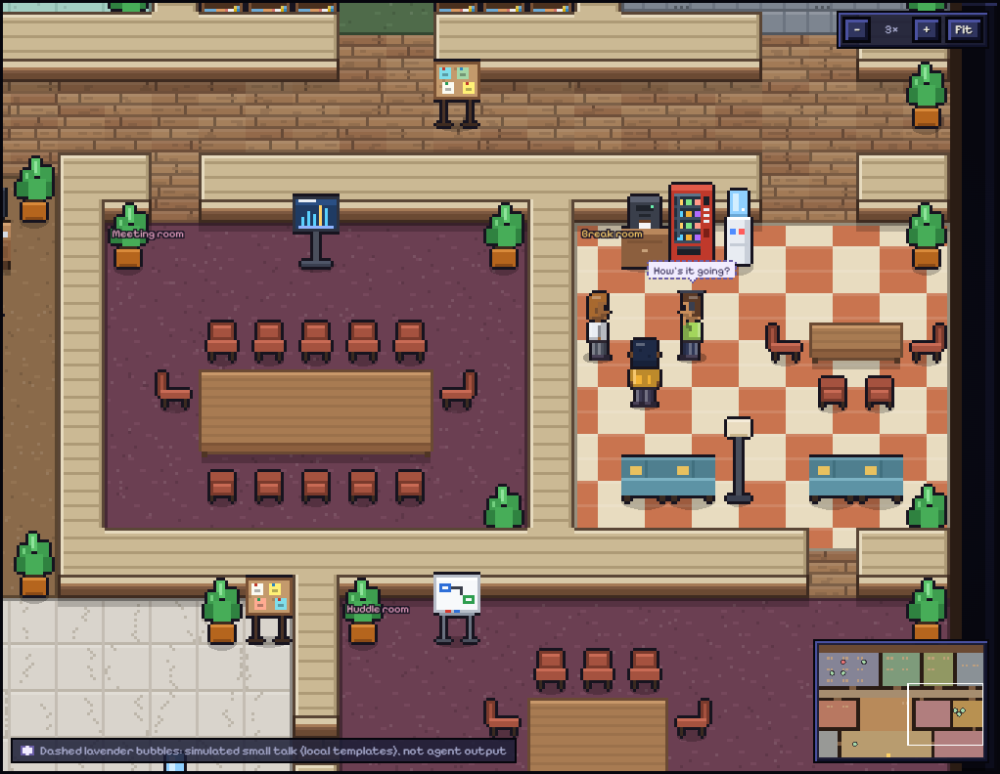

Details: [docs/COLLABORATION.md](docs/COLLABORATION.md).

## Simulated office life

Agents whose **real** status is idle get a small, local, simulated life: coffee, water, snacks, the restroom (its door sign turns red), the couch, a window, books, the notice board or whiteboard, watering plants, stretching, short walks, chats with another idle agent, and meetings.

- **Clearly simulated.** Chat lines appear in **dashed lavender bubbles** and come from a fixed table of local template lines, chosen by rules over generic observed facts ("just finished", "a test failed recently"). They are never generated, never real agent output, and the office shows a legend saying so. The full vocabulary is listed in [docs/SIMULATION.md](docs/SIMULATION.md).
- **Visitors.** People with a lavender visitor badge come in through the door, check in at reception, look around the rooms, get a coffee, use the restroom, chat with each other and leave again, so the office is alive even when no agent is idle. They are never agents: they cannot be selected, they are not counted anywhere, and they step aside when an agent needs their spot. Turn them off under **Settings → Simulated visitors**.
- **Real status wins.** Agents that are working, waiting, failed or unknown never leave their desk. When real work, a permission prompt or a question arrives, the agent hurries back. The desk monitor and the inspector keep showing the real status while an agent is away, and at most about half of the idle agents are away at once.
- **Your choice.** Toggle **Idle life** in the top bar and set its frequency under **Settings**. The simulation pauses while another view is open.

<table>
<tr>
<td width="50%">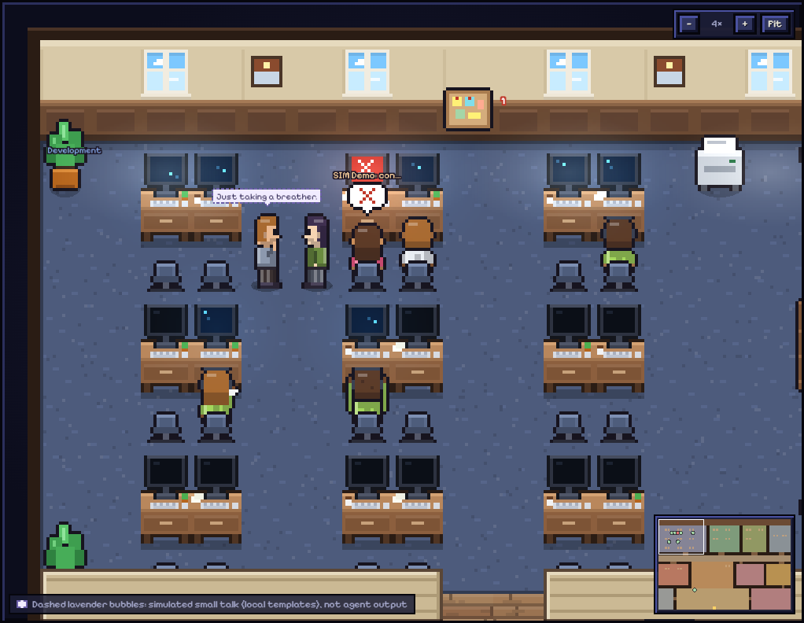</td>
<td width="50%">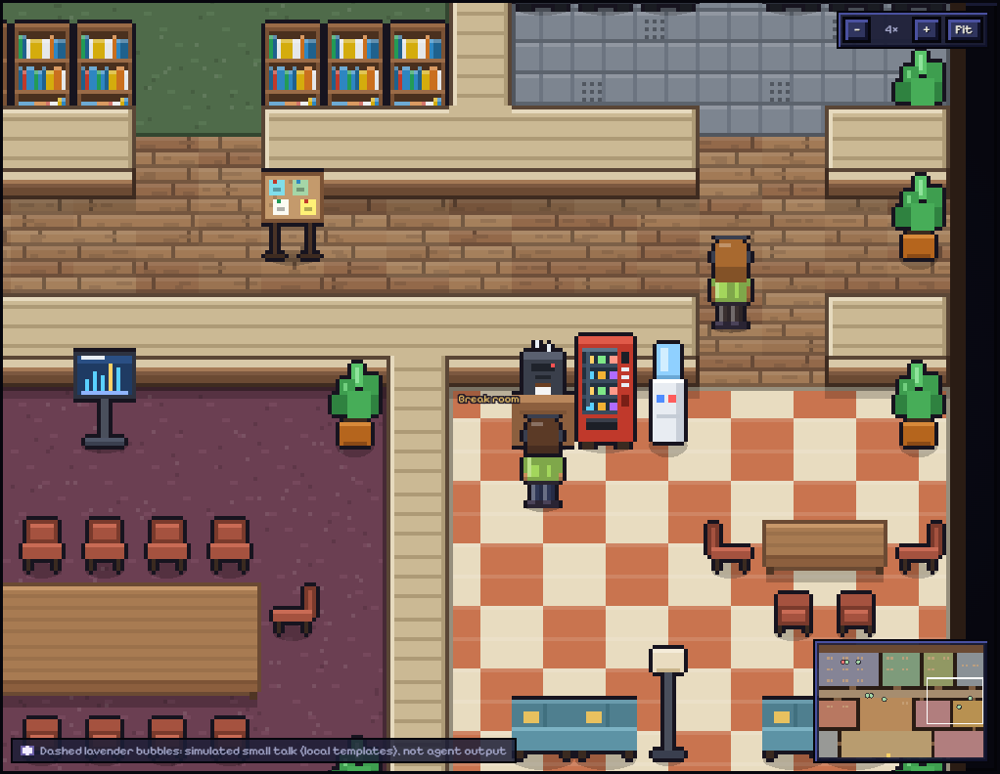</td>
</tr>
<tr>
<td><sub>Idle chat: a local template line in a dashed lavender bubble.</sub></td>
<td><sub>A simulated coffee break.</sub></td>
</tr>
</table>

## Sound

Turn on **Sound** in the top bar for calm background music and sound effects. Effects follow real events (an agent walks in, finishes a turn, needs permission or an answer, fails) and, more quietly, the office animation (coffee, the restroom, small talk, visitors). A soft keyboard ambience follows the agents that are really typing. Everything is synthesized in the page with the Web Audio API: no audio files, nothing downloaded. Music, effects and volume are under **Settings**. See [docs/SOUND.md](docs/SOUND.md).

## Token usage

Agent Office reports what Claude Code itself recorded and labels every number with its source:

| Shown | Where it comes from |
| --- | --- |
| **Context size** (inspector) | The latest API call recorded in the session's transcript: input + cache read + cache write tokens, plus output tokens. |
| **Transcript-observed tokens** (Analytics, History) | `usage` of assistant messages in the transcripts, summed once per message id, per session, agent, project and model. Subagent transcripts are included. |
| **Reported by Claude Code** | The latest cost record Claude Code wrote into a session transcript, shown as recorded, when present. |
| **Estimate from your price table** | Only if you create `~/.agent-office/pricing.json` with your own prices. Agent Office ships no prices and never guesses them. |

What stays **unknown**: sessions whose transcripts are not readable on this machine, anything Claude Code did not record, and your actual bill (subscriptions, discounts and cloud-provider pricing are invisible to the office). Office activity is never counted as Claude usage. The `pricing.json` format and the counting rules are in [docs/ANALYTICS.md](docs/ANALYTICS.md).

## Dashboard views

The tabs under the top bar switch between the office and these views (details in [docs/DASHBOARD.md](docs/DASHBOARD.md) and [docs/ANALYTICS.md](docs/ANALYTICS.md)):

| View | What it shows |
| --- | --- |
| **Tasks** | Task board from `TaskCreated` / `TaskCompleted` hooks: open, completed, and open when the session ended. Also opens from the cork board in the office. |
| **Errors** | Failed tools and turns, permission and input waits, likely test failures, repeated failures and quiet agents, each with its evidence. |
| **Git** | Read-only `git status` and recent commits for the agents' working directories (no fetch, no writes, no shell). |
| **Analytics** | Transcript-observed token usage, Claude Code's own cost records, optional estimates from your price table, and office activity counts. |
| **History** | Past sessions from the local journal (14 days by default) with metrics and a replay of their events in the office. |
| **Team** | Lead, subagent and teammate relations with their evidence, task handoffs, parallel work and the simulated meetings in progress. |
| **Settings** | Animation frame rate, idle-life frequency, room labels, mini-map, reduced motion and department rules (stored in the browser). |

## Configuration

**Environment variables**

| Variable | Purpose |
| --- | --- |
| `AGENT_OFFICE_HOME` | Data directory (default `~/.agent-office`). |
| `CLAUDE_CONFIG_DIR` | Claude Code config directory to watch (default `~/.claude`). |
| `AGENT_OFFICE_INFERENCE_HOSTS` | Extra hosts (comma-separated) that the runtime guard treats as inference hosts. |

**CLI** (`npx agent-office <command> [options]`, or `node packages/monitor/dist/cli.cjs`)

| Command | Purpose |
| --- | --- |
| `start` | Start the monitor on `http://127.0.0.1:<port>`. |
| `status` | Show configuration, hook status and whether a monitor is running. |
| `install-hooks` / `uninstall-hooks` | Add or remove only the Agent Office hooks (dry run unless `--yes`). |
| `simulate` | Send a SIMULATED demo scenario to a running monitor. |

| Option | Purpose |
| --- | --- |
| `--port <n>` | Monitor port (default 47821, stored in `config.json`). |
| `--home <dir>` | Agent Office data directory. |
| `--claude-dir <dir>` | Additional Claude config directory to watch (repeatable). |
| `--scope user\|project`, `--project <dir>` | Install or uninstall in `<claude-dir>/settings.json` (default) or `<project>/.claude/settings.local.json`. |
| `--mode command\|http` | Hook transport. `command` (default) is async and silent when the monitor is down; `http` has lower overhead, but Claude Code reports a hook error while the monitor is down, and `SessionStart` still uses a command hook. |
| `--yes` | Apply an install or uninstall instead of printing the plan. |
| `--open` | Open the office in the default browser after starting. |
| `--dev` | Allow the Vite dev server origin to connect. |
| `--no-discovery` | Disable registry and transcript discovery (hooks only). |
| `--loop`, `--linger <seconds>` | `simulate`: repeat the demo, or keep finished demo sessions idle for this long (default 6). |

**What lives in `~/.agent-office`**

| File | Contents |
| --- | --- |
| `config.json` | Port, the random local access token and extra Claude config directories (`claudeConfigDirs`). |
| `state.json`, `layout.json` | The last office state (restored on restart) and your saved layout. |
| `bin/agent-office-hook.cjs` | The hook forwarder that your Claude Code settings point to. |
| `spool/` | Hook events captured while the monitor was down, replayed on start. |
| `history/` | The sanitized event journal (`YYYY-MM-DD.jsonl` plus `index.json`), kept 14 days and at most 256 MiB by default. |
| `pricing.json` | Optional: your own per-model prices for cost estimates. |

**VS Code settings:** `agentOffice.port`, `agentOffice.autoStartMonitor`, `agentOffice.claudeConfigDirs`, `agentOffice.showOnlyCurrentWorkspace`, `agentOffice.nativeNotifications`.

## Screenshot gallery

All images were captured from the running app by [`scripts/capture-screenshots.cjs`](scripts/capture-screenshots.cjs) with the built-in **SIMULATED** demo data, the lighting fixed to 2 pm (`?hour=14`) and the idle-life frequency set to *High*. No agent in them is real.

<table>
<tr>
<td width="50%">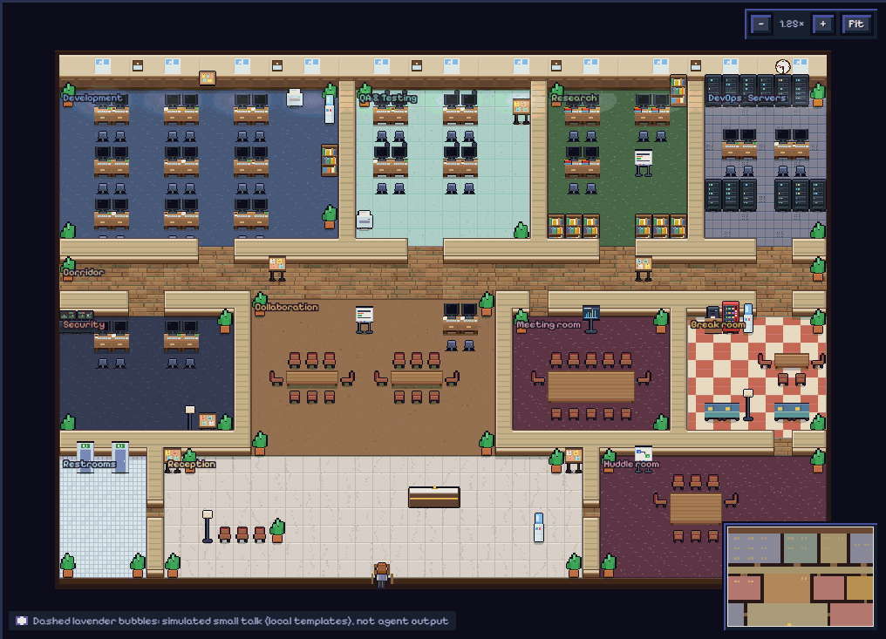<br><sub>Sessions and subagents walk in and take their desks.</sub></td>
<td width="50%">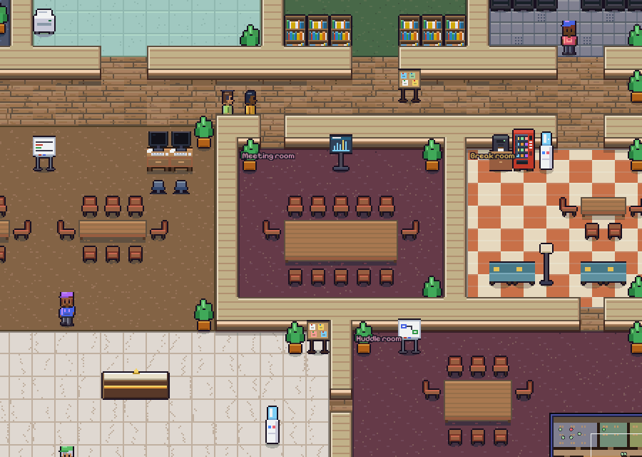<br><sub>Idle agents gather for a simulated meeting.</sub></td>
</tr>
<tr>
<td>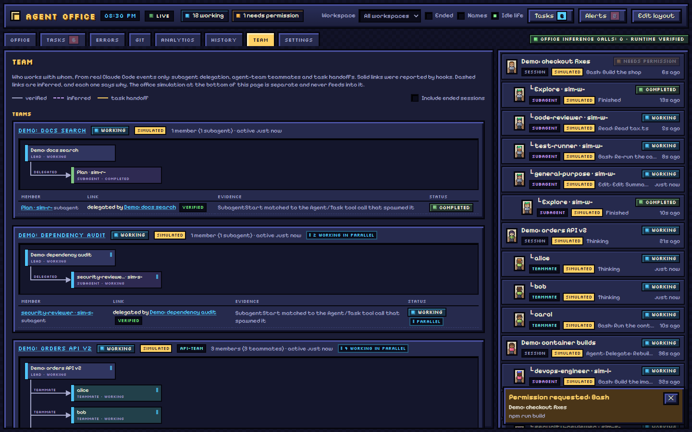<br><sub>Team view: verified links, handoffs and parallel work.</sub></td>
<td>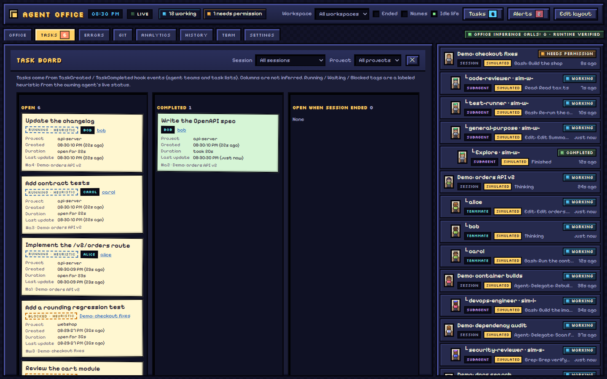<br><sub>Task board built from task hooks.</sub></td>
</tr>
<tr>
<td>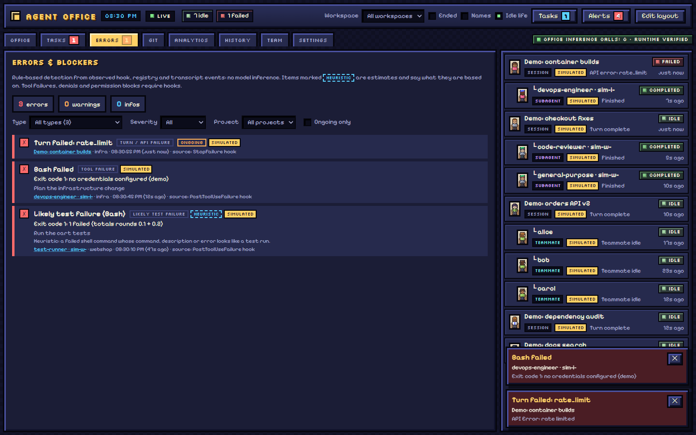<br><sub>Errors view: every item names its evidence.</sub></td>
<td>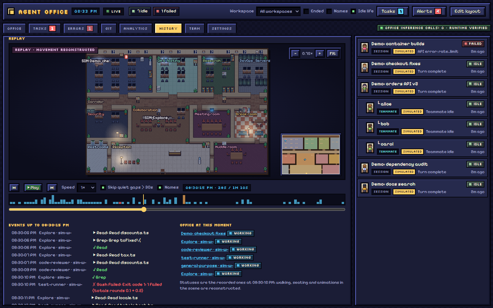<br><sub>History: replay a recorded session in the office.</sub></td>
</tr>
<tr>
<td>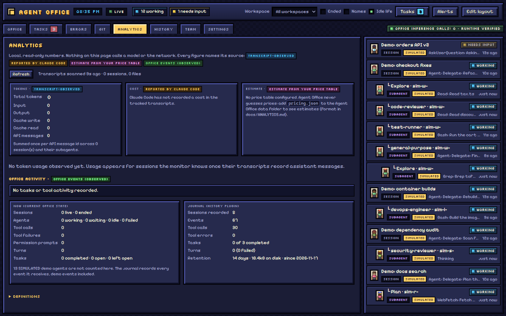<br><sub>Analytics with demo data: there are no transcripts, so token totals stay at zero instead of being estimated.</sub></td>
<td>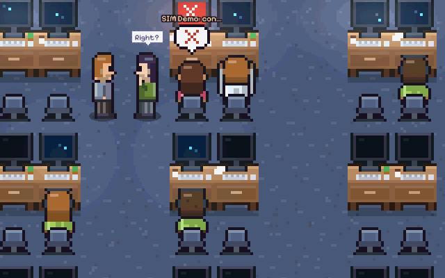<br><sub>Idle chat with template lines.</sub></td>
</tr>
</table>

## Troubleshooting

<details>
<summary><strong>Port 47821 is already in use</strong></summary>

`start` first checks whether an Agent Office monitor already answers on the port and reuses it. If another program holds the port, it prints `Port 47821 is in use by another process that is not answering as Agent Office`. Stop that process (it may be a stale monitor) or pick another port with `npx agent-office start --port <n>`. The new port is saved in `~/.agent-office/config.json`, which the default (command) hook reads on every event. If you installed hooks with `--mode http`, re-run `install-hooks` so their URL uses the new port. In VS Code, set `agentOffice.port` to match.
</details>

<details>
<summary><strong>Agents appear, but without tool activity, subagents or tasks</strong></summary>

That is the registry-only mode: hooks are not installed (the office shows a "Limited data" banner). Run `npx agent-office status` to see the hook state of each Claude config directory, then `npx agent-office install-hooks` (dry run) and `--yes`. If `disableAllHooks` is `true` in your settings, Claude Code runs no hooks at all. Restart a Claude Code session if its events still do not appear.
</details>

<details>
<summary><strong>Hooks installed in two scopes (events arrive twice)</strong></summary>

If the hooks are in both `~/.claude/settings.json` and a project's `.claude/settings.local.json` (or `.claude/settings.json`), Claude Code may run both. The office shows a warning banner and the monitor drops exact duplicates, but you should remove one copy: `npx agent-office uninstall-hooks --yes` for the user copy, or add `--scope project --project <dir>` for the project copy.
</details>

<details>
<summary><strong>Titles or token usage appear late on Windows</strong></summary>

Opening a transcript that Claude Code is still writing can take seconds on Windows, likely because antivirus rescans the growing file. Each transcript read is time-boxed and slow files are retried later; session status and liveness come from the registry scan, which never waits for transcripts.
</details>

<details>
<summary><strong>The VS Code panel stays empty or says it cannot connect</strong></summary>

Check `agentOffice.port` matches the monitor's port and that `agentOffice.autoStartMonitor` is on (or start a monitor yourself with `npm start`). **Agent Office: Show Monitor Log** shows what the embedded monitor is doing, and **Agent Office: Restart Monitor** restarts it. The webview has a strict Content Security Policy and receives data only through VS Code messaging; it never connects anywhere itself.
</details>

<details>
<summary><strong>The office looks wrong or empty in the browser</strong></summary>

Make sure you ran `npm run build` after pulling changes: the monitor serves `packages/ui/dist`. "Waiting for the monitor…" means the page cannot reach the WebSocket; reload after `npm start` reports `Agent Office running at http://127.0.0.1:47821/`.
</details>

## Project structure

```
packages/
  core/              Event schema, hook payload normalisation, secret redaction, the pure reducer,
                     selectors, layout model, protocol and plugin contracts
  monitor/           Node service: HTTP ingest, WebSocket broadcast, registry and transcript discovery,
                     spool, persistence, hook installer, CLI, hook forwarder, plugins
                     (inference guard, usage, history, git) and the demo scenarios (simulate.ts)
  ui/                React + Vite + PixiJS: office scene with procedural pixel art, camera, walking and
                     desk assignment, idle life and meetings, inspector, dashboard views, layout editor
  vscode-extension/  Monitor connection with leader election, webview, status bar, notifications,
                     hook commands
scripts/             Lint, zero-token browser e2e, smoke tests, publish audit, screenshot capture
docs/                Technical documentation and the screenshots
```

## Development and testing

```bash
npm run dev:ui                                    # Vite dev server on http://127.0.0.1:5173
npx agent-office start --dev                      # monitor that accepts the Vite origin
npm run typecheck                                 # tsc --noEmit for every package
npm run lint                                      # strict TypeScript checks + repository rules
npm test                                          # unit and integration tests (Vitest)
npm run e2e:zero-token                            # built app in headless Edge: every request intercepted, 0 inference calls
npm run smoke:webview                             # webview build under the extension CSP in headless Edge
npm run smoke:extension                           # bundled extension activated against a mock VS Code API
npm run audit:publish -- "<your-name>"            # pre-publish scan for secrets, local paths, usernames and tokens
node scripts/capture-screenshots.cjs              # regenerate the README screenshots from the demo
```

The browser checks use an installed Microsoft Edge through `playwright-core`. [docs/VALIDATION.md](docs/VALIDATION.md) explains what each check proves, how to run it safely and the measured performance numbers. Contribution guidelines are in [CONTRIBUTING.md](CONTRIBUTING.md).

## Uninstall

1. **Remove the hooks** (only Agent Office handlers are removed; a backup of the settings file is written first):

   ```bash
   npx agent-office uninstall-hooks                                        # dry run
   npx agent-office uninstall-hooks --yes
   npx agent-office uninstall-hooks --scope project --project <dir> --yes  # if you installed per project
   ```

   In VS Code you can use **Agent Office: Remove Claude Code Hooks…** instead.
2. **Stop the monitor** (Ctrl+C in its terminal) and close Agent Office panels in VS Code.
3. **Remove the extension**, if installed: `code --uninstall-extension local.agent-office-vscode`.
4. **Delete the data directory** `~/.agent-office` (on Windows `%USERPROFILE%\.agent-office`), or your `AGENT_OFFICE_HOME`. It holds the local token, state, layout, history journal, spool and the hook forwarder.
5. Optionally delete the `settings.json.agent-office-backup-*` files next to your Claude Code settings once you no longer need them.

## Contributing

Issues and pull requests are welcome. Please read [CONTRIBUTING.md](CONTRIBUTING.md) first: in short, keep everything local, never add model calls or network access beyond loopback, keep real and simulated data clearly apart, and add tests for behaviour changes.

## License and attribution

[MIT](LICENSE) © 2026 [JonathanClintonW](https://github.com/JonathanClintonW). Third-party components and fonts are listed in [THIRD_PARTY_NOTICES.md](THIRD_PARTY_NOTICES.md); all pixel art is original and drawn procedurally in code.

Created and maintained by **[JonathanClintonW](https://github.com/JonathanClintonW)**.

*Claude and Claude Code are products of Anthropic. Claude Agent Office is an independent open-source project; it is not affiliated with, endorsed by or sponsored by Anthropic.*
